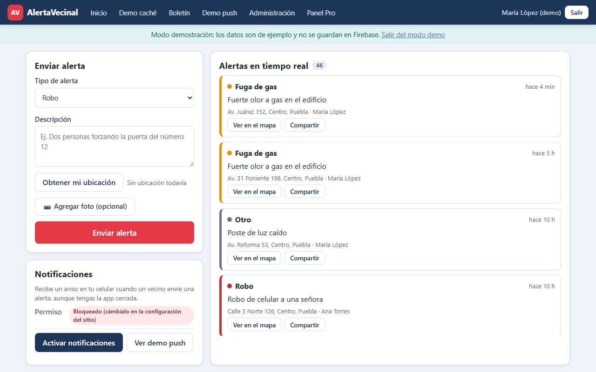
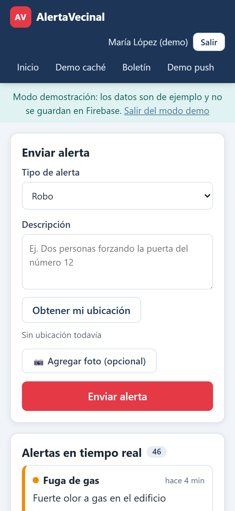
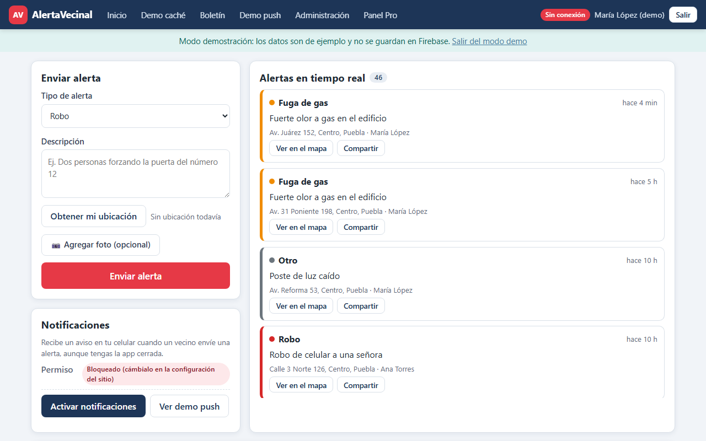
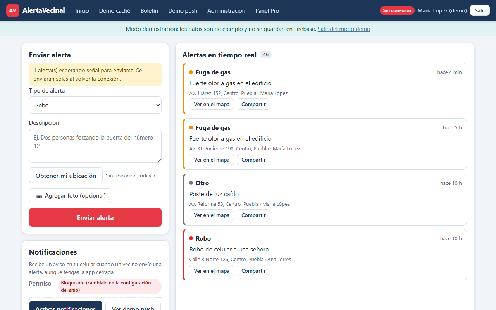
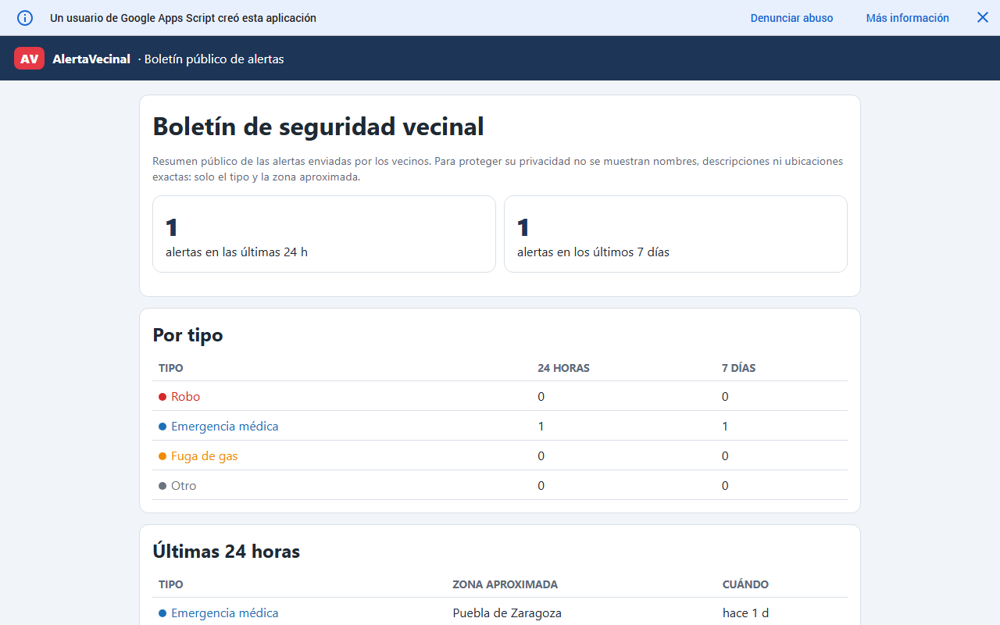
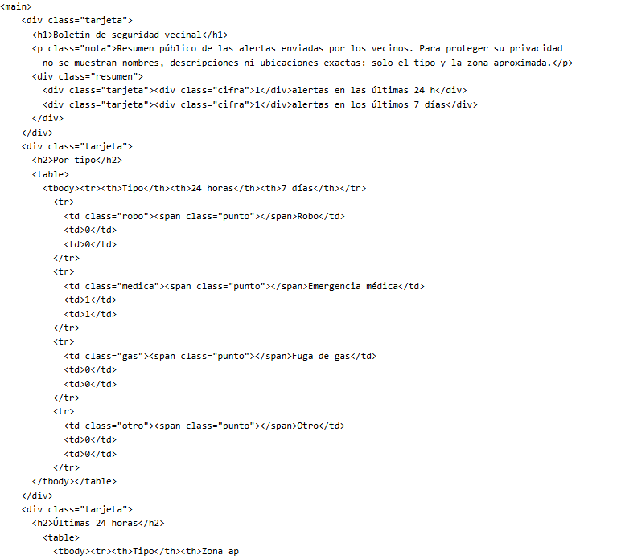
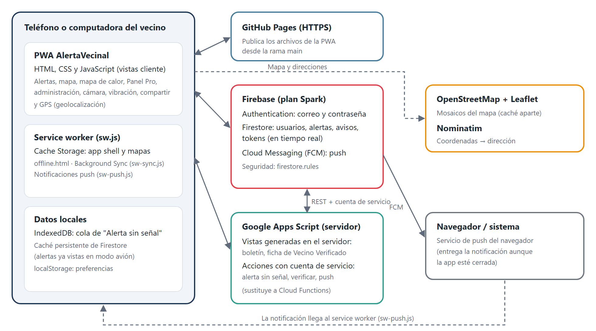

# AlertaVecinal

**Red de seguridad vecinal hecha como aplicación web progresiva (PWA).** Los vecinos se registran, un administrador los aprueba y cualquier vecino aprobado puede enviar alertas (robo, emergencia médica, fuga de gas u otro) con su ubicación. Las alertas llegan en tiempo real a la lista, al mapa y como notificación push, incluso sin conexión.

Proyecto del **Producto 2 · Unidad II** de *Aplicaciones Web Progresivas* · Profesora **Mather Xóchitl Mendoza Piscil** · Grupo **10° D** · Ingeniería en Desarrollo y Gestión de Software · Universidad Tecnológica de Puebla.

| | Enlace |
|---|---|
| 🌐 **Aplicación publicada** | https://jazyelae.github.io/alertavecinal/ |
| 🧪 **Modo demostración** (datos de ejemplo, sin cuenta) | https://jazyelae.github.io/alertavecinal/?demo=1 |
| ⚙️ **Backend (Google Apps Script)** | https://script.google.com/macros/s/AKfycbyA-8YNUHxTZ0XILx0vCNW0PV-lX_SlT-zDDEMG_7wUcgRelPpH_9_MfC0GzfSZihiJkg/exec |
| 📰 Vista de servidor: Boletín público | [`…/exec?vista=boletin`](https://script.google.com/macros/s/AKfycbyA-8YNUHxTZ0XILx0vCNW0PV-lX_SlT-zDDEMG_7wUcgRelPpH_9_MfC0GzfSZihiJkg/exec?vista=boletin) |
| 🏅 Vista de servidor: Ficha de Vecino Verificado | `…/exec?vista=verificado&uid=<uid>` (se abre desde **Panel Pro → Ver mi ficha pública**) |
| 🔥 Vista de servidor: Reporte de mapa de calor | `…/exec?vista=mapacalor` (código en el repo; pendiente de publicar en el backend) |
| 📦 Repositorio | https://github.com/JazyelAe/alertavecinal |

---

## Índice
1. [Capturas](#1-capturas)
2. [Funcionalidades](#2-funcionalidades)
3. [Cumplimiento del Producto 2](#3-cumplimiento-del-producto-2)
4. [Arquitectura](#4-arquitectura)
5. [Estructura del proyecto](#5-estructura-del-proyecto)
6. [Cómo ejecutarla](#6-cómo-ejecutarla)
7. [Pruebas](#7-pruebas)
8. [Entregables](#8-entregables)
9. [Equipo y créditos](#9-equipo-y-créditos)

---

## 1. Capturas

| Panel del vecino (escritorio) | En el celular |
|---|---|
|  |  |

| Sin conexión: la app sigue abriendo | Alerta guardada sin señal |
|---|---|
|  |  |

| Vista generada en el servidor (Boletín) | Su código fuente: datos ya incrustados en el HTML |
|---|---|
|  |  |

Más evidencias en [`docs/producto2/evidencias/`](docs/producto2/evidencias/).

---

## 2. Funcionalidades

**Para el vecino**
- Registro con nombre, correo, calle y número. La cuenta queda **pendiente** hasta que un administrador la aprueba.
- Enviar alertas con tipo, descripción, **ubicación GPS**, dirección automática y **foto de la cámara**.
- Lista de alertas y **mapa** en tiempo real; cada alerta se puede **compartir** y hace **vibrar** el teléfono al llegar.
- **Notificaciones push** aunque la app esté cerrada.
- **Instalar la app** en la pantalla de inicio y usarla **sin conexión**.

**Para el administrador**
- Aprobar, suspender, eliminar y cambiar el rol de los usuarios.
- Enviar avisos a todos los vecinos.
- **Verificar el domicilio** de un vecino (lo valida el servidor).

**Aportaciones del equipo**
| Aportación | Integrante | Qué hace |
|---|---|---|
| **Alerta sin señal** | Jaziel | Si no hay internet, la alerta se guarda en IndexedDB y se envía sola al volver la conexión (Background Sync). El backend la deduplica y le pone la hora del servidor. |
| **Mapa de calor de incidentes** | Luis | Capa de calor con filtros por tipo y fecha, resumen de las calles con más incidentes y un reporte generado en el servidor. |
| **Vecino Verificado Pro** | Yeudiel | **Panel Pro** para comités vecinales: indicadores de la colonia con datos reales, alertas por vecino, alertas útiles, antigüedad e insignias, y una ficha pública del vecino generada en el servidor. |

---

## 3. Cumplimiento del Producto 2

### Aplicación en el repositorio
| Requisito | Dónde está | Cómo comprobarlo |
|---|---|---|
| **Vistas generadas del lado del cliente** | `index.html`, `admin.html`, `estadisticas.html`; módulos de `js/` que pintan con JavaScript (`alertas.js` → `pintarLista()`, `admin.js` → `pintar()`, `estadisticas.js` → `pintar()`, `mapa.js` → `pintarMarcadores()`) | Abrir la app y ver el código fuente: el HTML llega vacío y JavaScript agrega los datos |
| **Vistas generadas del lado del servidor** | `apps-script/` con HtmlService: `Boletin.gs` + `vista_boletin.html`, `Verificado.gs` + `vista_verificado.html`, `MapaCalor.gs` + `vista_mapacalor.html`; router en `Comun.gs` (`doGet`, `renderVista_`) | Abrir `…/exec?vista=boletin` y ver el código fuente: los datos ya vienen en el HTML, con el pie "Generado en el servidor" |
| **Datos locales** | IndexedDB en `js/offline-sync.js` y `sw-sync.js` (cola de alertas sin señal); `localStorage` en `js/push.js` | DevTools → Application → IndexedDB y Local Storage |
| **Datos remotos** | Firestore (`js/auth.js`, `js/alertas.js` con `onSnapshot`), backend de Apps Script, Nominatim (`js/mapa.js`) | Enviar una alerta y verla aparecer en otro navegador |
| **Datos offline** | `sw.js` (precaché del *app shell* con `cacheFirst`, `networkFirst` y `staleWhileRevalidate`; `offline.html`); persistencia de Firestore (`persistentLocalCache` en `js/auth.js`); Background Sync (`sw-sync.js`); demo de la API Cache en `demo-cache.html` | DevTools → Network → Offline y recargar; enviar una alerta sin red |
| **Notificaciones** | `js/push.js` y `sw-push.js` (Firebase Cloud Messaging); envío desde el backend en `apps-script/Push.gs` (`accion_push`); avisos del administrador en `js/admin.js` | Activar notificaciones, cerrar la app y enviar una alerta desde otro dispositivo; `demo-push.html` |
| **Elementos físicos del dispositivo** | GPS (`navigator.geolocation` en `js/alertas.js`), cámara (`<input capture="environment">` en `index.html`), vibración (`navigator.vibrate`), compartir (`navigator.share`) | Enviar una alerta con ubicación y foto desde el teléfono |

### Documento del Producto 2
| Parte que pide la profesora | Dónde está |
|---|---|
| Justificación de las plataformas y herramientas | Sección 2 del documento; aportes en [`docs/producto2/`](docs/producto2/) |
| Parámetros de configuración | Sección 3 del documento: `manifest.json`, `sw.js`, `js/firebase-config.js`, `firestore.rules`, `apps-script/appsscript.json` |
| Reporte de pruebas | Sección 4 del documento; pruebas automáticas en `apps-script/pruebas/` y `docs/producto2/pruebas/` |
| Evidencias de las características de la PWA | Sección 5 del documento; capturas en [`docs/producto2/evidencias/`](docs/producto2/evidencias/) |
| Vínculo (URL) de la aplicación publicada | https://jazyelae.github.io/alertavecinal/ |

El PDF del equipo se genera con `docs/producto2/generar_pdf.py` y se guarda en `entregables/Producto2_AlertaVecinal_Equipo.pdf` (pendiente al momento de este commit).

---

## 4. Arquitectura



- **PWA (navegador):** HTML, CSS y JavaScript puro, sin framework ni compilación. Cada función es un módulo en `js/` que se carga solo; si uno falta, la app sigue funcionando.
- **Firebase (plan Spark, gratuito):** Authentication (correo y contraseña), Firestore (usuarios, alertas, avisos, tokens) y Cloud Messaging (push).
- **Google Apps Script:** backend gratuito en lugar de Cloud Functions, que requieren el plan de pago. Genera las vistas del servidor y ejecuta las acciones que necesitan la cuenta de servicio: push, alerta sin señal y verificación.
- **OpenStreetMap + Leaflet + Nominatim:** mapas y direcciones sin clave de API.
- **GitHub Pages:** publicación con HTTPS desde la rama `main`.

---

## 5. Estructura del proyecto

```
alertavecinal/
├── index.html              Panel del vecino: acceso, enviar alerta, lista y mapa      (Jaziel)
├── admin.html              Administración de usuarios y avisos                       (Yeudiel)
├── estadisticas.html       Panel Pro · Vecino Verificado Pro                         (Yeudiel)
├── demo-cache.html         Demostración de la API Cache                              (Jaziel)
├── demo-push.html          Demostración de notificaciones                            (Luis)
├── offline.html            Página que se muestra sin conexión                        (Jaziel)
├── manifest.json           Manifiesto de la PWA                                      (Jaziel)
├── sw.js                   Service worker: caché (importa sw-push.js y sw-sync.js)   (Jaziel)
├── sw-push.js              Service worker: notificaciones push y vibración           (Luis)
├── sw-sync.js              Service worker: Background Sync de alertas sin señal      (Jaziel)
├── firestore.rules         Reglas de seguridad de Firestore                          (Jaziel)
├── css/estilos.css         Estilos de toda la app                                    (Jaziel)
├── js/
│   ├── firebase-config.js  Configuración web de Firebase y URL del backend           (Jaziel)
│   ├── auth.js             Sesión, registro, roles, persistencia y datos de ejemplo  (Jaziel)
│   ├── app.js              Registro del service worker y estado de la red            (Jaziel)
│   ├── alertas.js          Enviar y listar alertas; GPS, cámara, vibrar, compartir   (Jaziel)
│   ├── offline-sync.js     Aportación «Alerta sin señal» (IndexedDB)                 (Jaziel)
│   ├── cache-demo.js       Botones de demo-cache.html                                (Jaziel)
│   ├── mapa.js             Mapa con Leaflet y direcciones con Nominatim              (Luis)
│   ├── push.js             Notificaciones push con FCM                               (Luis)
│   ├── heatmap.js          Aportación «Mapa de calor de incidentes»                  (Luis)
│   ├── admin.js            Administración de usuarios y verificación de domicilio    (Yeudiel)
│   ├── instalar.js         Botón «Instalar app»                                      (Yeudiel)
│   └── estadisticas.js     Aportación «Vecino Verificado Pro»                        (Yeudiel)
├── apps-script/            Backend en Google Apps Script (se sube con clasp)
│   ├── Comun.gs            Router, Firestore REST, sesión y vistas                   (Jaziel)
│   ├── Boletin.gs          Vista: boletín público de alertas                         (Jaziel)
│   ├── SinSenal.gs         Acción: alertas enviadas sin señal                        (Jaziel)
│   ├── Push.gs             Acción: envío de notificaciones push                      (Luis)
│   ├── MapaCalor.gs        Vista: reporte del mapa de calor                          (Luis)
│   ├── Verificado.gs       Vista: ficha de Vecino Verificado · acción: verificar     (Yeudiel)
│   ├── vista_*.html        Plantillas de las vistas de servidor
│   └── pruebas/            Pruebas locales con un simulador de Apps Script (no se suben)
├── scripts/                Envío de push desde la terminal (alternativa)             (Luis)
├── docs/
│   ├── specs/              Especificación de cada tarea, con sus pruebas
│   └── producto2/          Secciones del documento, evidencias y generador del PDF
└── entregables/            PDF de los subproductos y del Producto 2
```

---

## 6. Cómo ejecutarla

### 6.1 Ver la app en tu computadora (sin cuenta, con datos de ejemplo)
Solo necesitas Node.js. En la carpeta del proyecto:

```bash
npx --yes http-server -p 3000 -c-1
```

Abre **http://localhost:3000/?demo=1** en una ventana de incógnito nueva. `?demo=1` carga datos de ejemplo sin conectarse a Firebase: sirve para probar y tomar capturas.

> En Windows PowerShell, si aparece *"running scripts is disabled"*, usa `npx.cmd` en lugar de `npx`.
> Usa siempre una ventana de incógnito nueva: en una ventana normal puede quedar activo el service worker de una versión anterior.

### 6.2 Con tu propio proyecto de Firebase
1. En la [consola de Firebase](https://console.firebase.google.com/) crea un proyecto (plan **Spark**).
2. **Authentication** → activa *Correo electrónico/contraseña* y agrega tu dominio en *Dominios autorizados*.
3. **Firestore** → crea la base y publica las reglas de [`firestore.rules`](firestore.rules).
4. **Configuración del proyecto** → registra una app web y copia su `firebaseConfig` en [`js/firebase-config.js`](js/firebase-config.js).
5. **Cloud Messaging** → genera la clave pública **VAPID** y ponla en el mismo archivo.
6. Regístrate en la app y, en Firestore, cambia tu documento `usuarios/<tu uid>` a `rol: "admin"` y `estado: "aprobado"`. Ese primer administrador aprueba a los demás desde **Administración**.

### 6.3 Backend de Google Apps Script
```bash
npm i -g @google/clasp
clasp login
clasp push          # sube apps-script/ (lo indica .claspignore)
```
- En el editor de Apps Script → **Configuración del proyecto → Propiedades del script**, crea `SERVICE_ACCOUNT` con el JSON de la cuenta de servicio de Firebase.
- **Implementar → Nueva implementación → Aplicación web**: ejecutar como *Yo*, acceso *Cualquier usuario*. Copia la URL `/exec` en `self.URL_BACKEND` de `js/firebase-config.js`.
- Cada cambio en `apps-script/` necesita `clasp push` y una nueva versión de la implementación.

> 🔒 **Seguridad:** la cuenta de servicio (`serviceAccountKey.json` o el JSON de `SERVICE_ACCOUNT`) **nunca** se sube al repositorio. Solo va en las propiedades del script. La `firebaseConfig` web y la clave pública VAPID sí pueden ser públicas.

### 6.4 Publicar
GitHub Pages: **Settings → Pages → Deploy from a branch → `main` / raíz**. Si cambias archivos que guarda el service worker, sube `VERSION` en `sw.js` para que los usuarios reciban la versión nueva.

---

## 7. Pruebas

**Backend (sin subir nada a Google):** un simulador de Apps Script con Firestore en memoria.
```bash
node apps-script/pruebas/prueba_comun.mjs
node apps-script/pruebas/prueba_boletin.mjs
node apps-script/pruebas/prueba_sin_senal.mjs
node apps-script/pruebas/prueba_push.mjs
node apps-script/pruebas/prueba_mapacalor.mjs
node apps-script/pruebas/prueba_verificado.mjs
```

**Aplicación:** cada tarea tiene su especificación con los casos probados y sus resultados en [`docs/specs/`](docs/specs/). Las pruebas del documento del Producto 2 están en [`docs/producto2/pruebas/`](docs/producto2/pruebas/).

---

## 8. Entregables

| Documento | Archivo |
|---|---|
| Subproducto 4 · API Caché | [`entregables/Subproducto4_API_Cache.pdf`](entregables/Subproducto4_API_Cache.pdf) |
| Subproducto 5 · Aportación | [`entregables/Subproducto5_Aportacion.pdf`](entregables/Subproducto5_Aportacion.pdf) |
| Subproducto 6 · Notificaciones | [`entregables/Subproducto6_Notificaciones.pdf`](entregables/Subproducto6_Notificaciones.pdf) |
| Guía del repositorio | [`entregables/GUIA_REPOSITORIO.md`](entregables/GUIA_REPOSITORIO.md) · [PDF](entregables/GUIA_REPOSITORIO.pdf) |
| Producto 2 (documento del equipo) | `entregables/Producto2_AlertaVecinal_Equipo.pdf` (pendiente) |

---

## 9. Equipo y créditos

| Integrante | GitHub | Rama | Aportes principales |
|---|---|---|---|
| **Serrano Arana Jahir Jaziel** | [@JazyelAe](https://github.com/JazyelAe) | `jaziel` | Aplicación base y conversión a PWA, service worker y modo offline, **Alerta sin señal**, núcleo del backend en Apps Script, **Boletín** (vista de servidor), cámara, vibración y compartir, despliegue y documento del Producto 2 |
| **Xicali Diaz Luis Alberto** | [@LuisAlbertoXicaliDiaz](https://github.com/LuisAlbertoXicaliDiaz) | `luis` | Mapa con Leaflet y Nominatim, notificaciones push con FCM y desde Apps Script, **Mapa de calor de incidentes** y su **reporte** (vista de servidor), Subproducto 6 |
| **Gonzalez Barrios Yeudiel Nain** | [@yeudev-utp](https://github.com/yeudev-utp) | `yeudiel` | Panel de administración, botón de instalación, **Vecino Verificado Pro** (Panel Pro), **ficha de Vecino Verificado** (vista de servidor) y verificación de domicilio, Subproducto 5 y este README |

Los aportes de cada integrante se ven en sus commits y en [Insights → Contributors](https://github.com/JazyelAe/alertavecinal/graphs/contributors).

---

<sub>Universidad Tecnológica de Puebla · División de Tecnologías de la Información · Aplicaciones Web Progresivas · 10° D · Noviembre de 2026</sub>
