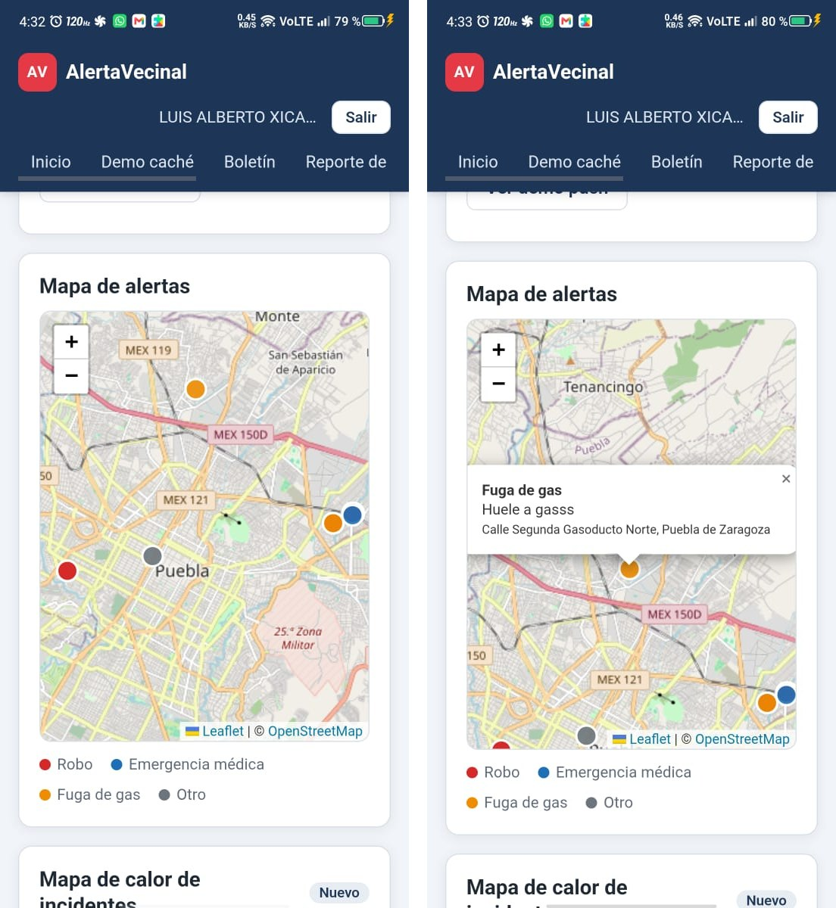
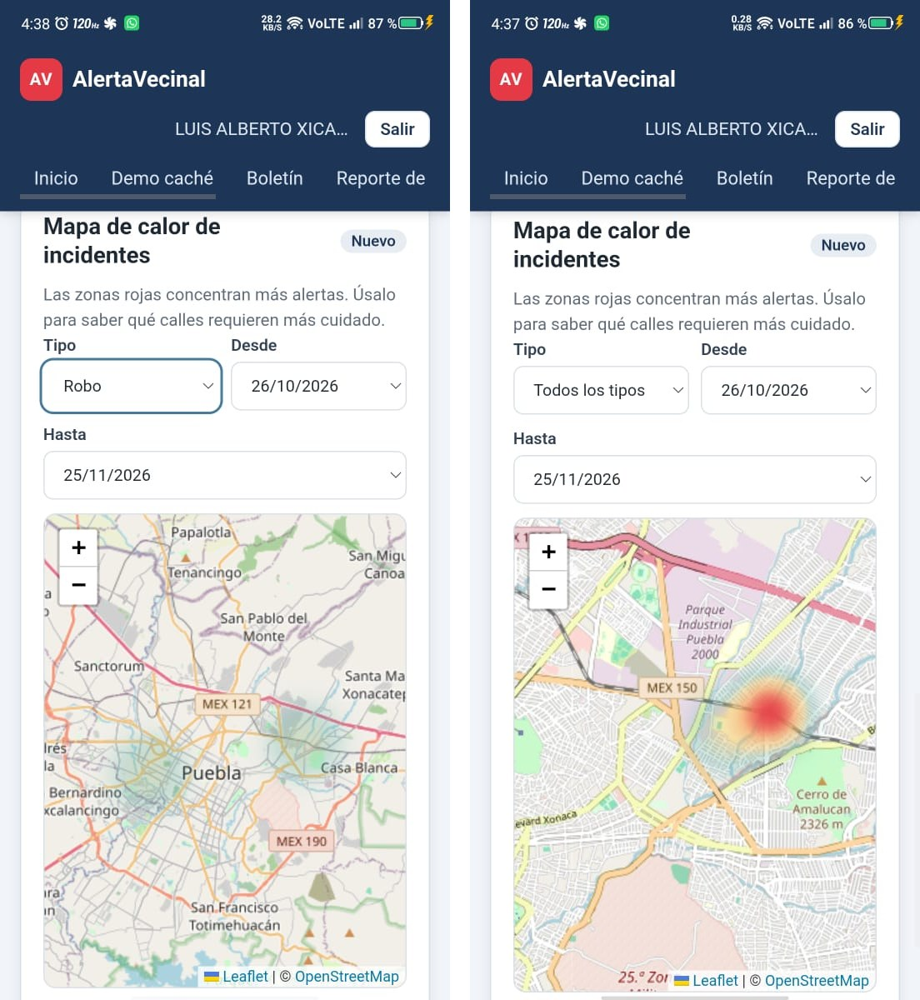
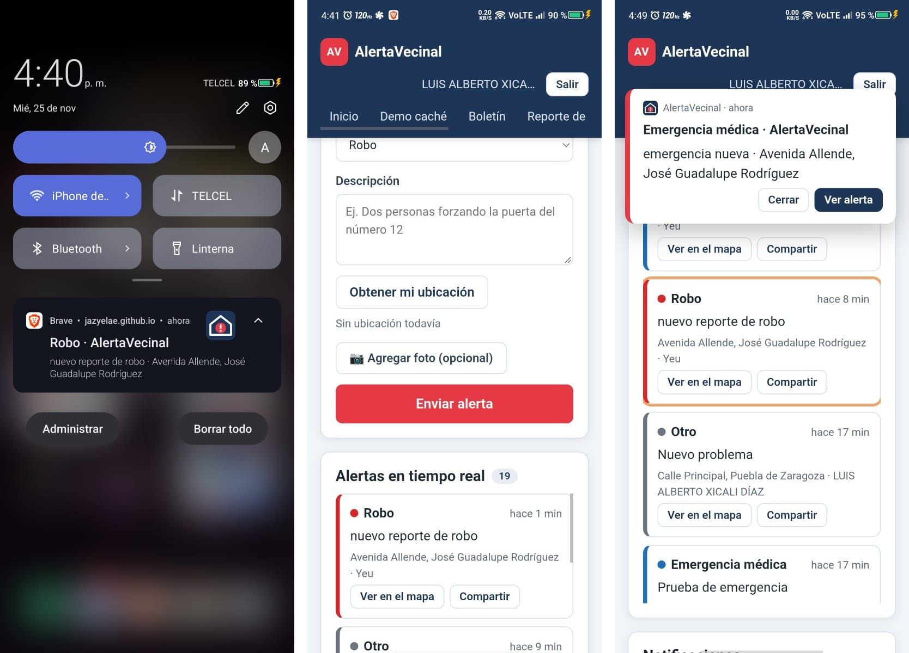
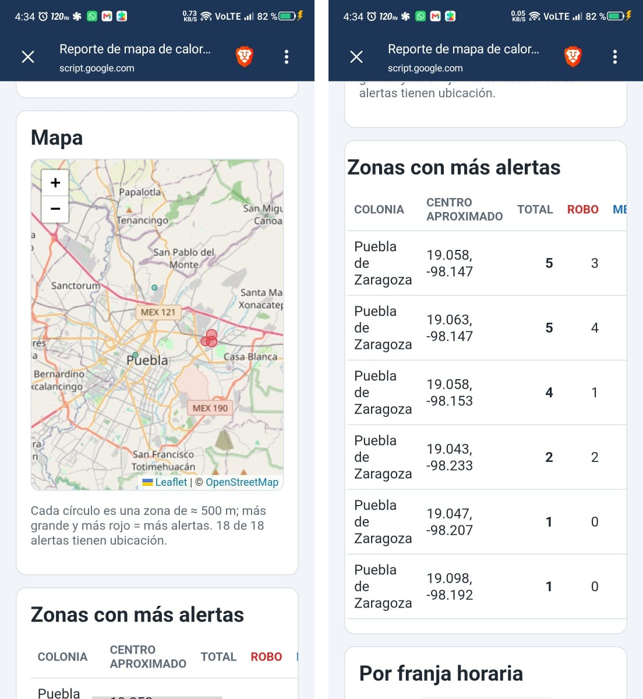
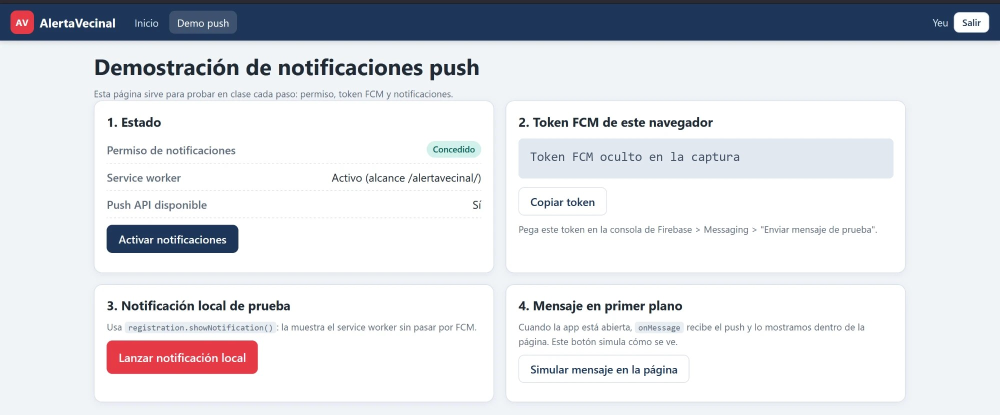

# Sección de Xicali Diaz Luis Alberto · Matrícula 2311081407

Integrante 2 del equipo AlertaVecinal · GitHub `LuisAlbertoXicaliDiaz` · rama `luis`.
Los números de los apartados corresponden a las secciones del documento del Producto 2 (spec 03).

---

## 7. Aportación: Mapa de calor de incidentes

En una colonia, una alerta aislada dice poco; lo que ayuda a prevenir es saber **dónde y a qué hora se repiten los incidentes**. Mi aportación, el **Mapa de calor de incidentes**, convierte las alertas de los vecinos en zonas de riesgo visibles, para que el comité vecinal decida dónde pedir patrullaje, alumbrado o vigilancia, y para que cada vecino sepa qué calles requieren más cuidado. Tiene una parte en el cliente y otra en el servidor:

- **Mapa de calor en la app (vista del lado del cliente):** `js/heatmap.js`. Con las alertas que el vecino ya recibe en tiempo real, pinta una capa de calor con el plugin Leaflet.heat sobre el mapa de OpenStreetMap. Tiene filtros por tipo de alerta y por rango de fechas, y un resumen con las calles más reportadas. Robo y fuga de gas pesan un poco más en la intensidad.
- **Reporte de mapa de calor (vista del lado del servidor):** `apps-script/MapaCalor.gs` y `apps-script/vista_mapacalor.html`. Google Apps Script lee las alertas de Firestore y las **agrega en el servidor**: zonas de unos 500 m con el conteo por tipo, la **colonia más reportada** y la **franja horaria más frecuente**. El navegador recibe la página con los datos ya calculados y solo dibuja el mapa. Es pública, así que no muestra nombres, descripciones, calles ni ubicaciones exactas.

Además desarrollé dos partes base de la PWA:

- **Mapa de alertas** (`js/mapa.js`): cada alerta aparece como un punto del color de su tipo; el botón "Ver en el mapa" de la lista centra el mapa en esa alerta. Con **Nominatim** las coordenadas del GPS se convierten en una dirección legible, como «Av. Juárez 152, Centro, Puebla».
- **Notificaciones push** (`js/push.js`, `sw-push.js`, `demo-push.html`): el vecino activa las notificaciones con un botón, su navegador se registra en Firebase Cloud Messaging y recibe las alertas aunque la app esté cerrada. El envío lo hace el servidor (`apps-script/Push.gs`), porque necesita la clave privada de la cuenta de servicio, que no puede ir en la app. La notificación vibra más largo si es una emergencia médica o una fuga de gas.

### Mis commits
| Commit | Fecha | Qué agrega |
|---|---|---|
| `Mapa de alertas con Leaflet y Nominatim` | 20/11/2026 | `js/mapa.js`: mapa de OpenStreetMap con las alertas y geocodificación inversa con Nominatim (PR #4) |
| `Notificaciones push con FCM` | 20/11/2026 | `js/push.js`, `sw-push.js`, `demo-push.html`, `scripts/`: permiso, token FCM, notificaciones en primer y segundo plano y la página de demostración (PR #4) |
| `Aportación: Mapa de calor de incidentes` | 20/11/2026 | `js/heatmap.js`: capa de calor con filtros y resumen de calles (PR #4) |
| `Documentación Subproducto 6` | 24/11/2026 | `entregables/Subproducto6_Notificaciones.pdf` (PR #20) |
| `Push desde el backend de Apps Script` | 24/11/2026 | `apps-script/Push.gs` (`accion_push`), vibración por tipo en `sw-push.js` y pruebas del backend (PR #20) |
| `Vista de servidor: reporte de mapa de calor` | 24/11/2026 | `apps-script/MapaCalor.gs`, `vista_mapacalor.html`, enlaces desde `js/heatmap.js` y pruebas (PR #20) |

---

## 2. Justificación de plataformas y herramientas (partes de Luis)

| Herramienta | Para qué | Por qué se eligió | Alternativa descartada |
|---|---|---|---|
| Leaflet 1.9.4 | Mapa de alertas, mapa de calor y mapa del reporte de servidor | Librería ligera (unos 40 KB), libre y sin clave de API; se carga desde CDN solo cuando el vecino aprobado abre el panel | Google Maps JavaScript API: requiere clave y cuenta de facturación |
| Mosaicos de OpenStreetMap | Imagen de fondo del mapa | Gratuitos con atribución; el service worker los guarda en caché para ver el mapa sin conexión | Mapbox: requiere clave y tiene límite de uso gratuito |
| Nominatim (geocodificación inversa) | Convertir las coordenadas del GPS en una dirección | Gratis, del mismo proyecto OpenStreetMap y en español con `accept-language=es` | Geocoding API de Google: de pago |
| Leaflet.heat 0.2.0 | Capa de calor sobre el mapa | Plugin de Leaflet muy pequeño que dibuja en `<canvas>` y acepta intensidad por punto | Heatmap.js: más pesado y sin integración directa con Leaflet |
| Push API + Notifications API | Recibir y mostrar notificaciones del sistema | Son los estándares del navegador para notificaciones push en una PWA; funcionan con la app cerrada gracias al service worker | Solo avisos dentro de la página: no llegan si la app está cerrada |
| Firebase Cloud Messaging (API HTTP v1) | Entregar el push a cada navegador | Gratis en el plan Spark, administra las suscripciones de cada navegador y ya es parte del proyecto Firebase | Servidor propio con la librería `web-push`: habría que hospedarlo y guardar las claves VAPID privadas |
| Google Apps Script (`Push.gs`) | Enviar el push con la cuenta de servicio | La clave privada queda en el servidor, en "Propiedades del script", y el envío no requiere el plan Blaze | Cloud Functions: plan de pago; `scripts/enviar-push.js` en una computadora: solo envía cuando alguien lo ejecuta a mano |
| Agregación en el servidor (`MapaCalor.gs`) | Reporte público del mapa de calor | Se calculan zonas, colonias y franjas sin enviar las alertas individuales al navegador: más privacidad y una página ligera | Mandar todas las alertas al navegador público: expondría descripciones y ubicaciones exactas |

---

## 3. Parámetros de configuración (partes de Luis)

### Firebase Cloud Messaging y VAPID
| Parámetro | Valor | Explicación |
|---|---|---|
| Clave VAPID pública | `FIREBASE_VAPID_KEY` en `js/firebase-config.js` (empieza con `BEFD…`) | Identifica a nuestra app ante el servicio de push del navegador. Es pública; el par privado lo guarda Firebase (consola → Configuración del proyecto → Cloud Messaging → Certificados push web) |
| `messagingSenderId` | `111909253533` | Remitente de FCM del proyecto `alertavecinal-10d` |
| SDK | Firebase 10.12.2: módulos en la página y versión *compat* en el service worker | Los service workers cargan scripts con `importScripts`, que no admite módulos |
| Service worker del push | `sw.js` hace `importScripts('sw-push.js')` | No se usa `firebase-messaging-sw.js`: `getToken()` recibe el registro de `sw.js` (`serviceWorkerRegistration`), así un solo service worker hace caché y push |
| Permiso | Solo con el botón "Activar notificaciones" | Los navegadores bloquean o penalizan pedir permiso al cargar la página |
| Token | Documento `tokens/{token}` con `uid`, `nombre`, `navegador` y `actualizado` | Las reglas solo dejan crear el token con el `uid` propio; lo leen o borran su dueño o el admin |
| API de envío | `POST https://fcm.googleapis.com/v1/projects/alertavecinal-10d/messages:send` | API HTTP v1 de FCM, autenticada con un token OAuth de la cuenta de servicio (scope `firebase.messaging`) |
| Cuenta de servicio | Propiedad del script `SERVICE_ACCOUNT` | Solo en Apps Script; nunca en el repositorio (`.gitignore` excluye `serviceAccountKey.json` y `*-firebase-adminsdk-*.json`) |

### Mensaje push (`apps-script/Push.gs` → `sw-push.js`)
| Parámetro | Valor | Explicación |
|---|---|---|
| Petición | `POST {accion: "push", idToken, tipo: "aviso" \| "alerta", id}` como `text/plain` | El texto no viaja en la petición: el servidor lo lee de Firestore, así nadie puede mandar un push falso |
| Validaciones | Sesión real y aprobada; avisos solo del admin; documento del mismo usuario y con 15 minutos como máximo | Evita que se reenvíen alertas viejas o ajenas |
| Sin repetir | Documento `envios/<tipo>-<id>` que solo se puede crear una vez | Si la página y la Alerta sin señal piden el mismo push, se envía una sola vez |
| Tipo de mensaje | Solo de datos (`data`): `titulo`, `cuerpo`, `url`, `tag`, `alertaId`, `tipo` | Así `sw-push.js` decide cómo mostrarlo; con un mensaje `notification` el SDK lo mostraría solo |
| Encabezados web push | `Urgency: high`, `TTL: 3600` | Entrega inmediata; si el teléfono está apagado, el mensaje espera hasta 1 hora |
| Destinatarios | Todos los tokens menos los del autor | El autor no se notifica a sí mismo |
| Limpieza | Se borran los tokens que FCM responde como `UNREGISTERED` | Navegadores desinstalados o con el permiso retirado |
| Vibración | `medica` y `gas`: `[300, 100, 300, 100, 300]`; otros: `[200, 100, 200]` (ms) | Elemento físico del dispositivo; Android lo usa, iOS lo ignora |
| `tag` y `renotify` | `alerta-<id>` y `true` | Si llegan el push y el aviso local de la misma alerta, se ve una sola notificación |
| Clic en la notificación | Enfoca la pestaña abierta o abre `./?alerta=<id>` | Lleva al vecino directo a la alerta |
| Compatibilidad | `js/push.js` usa `URL_BACKEND` y, si la acción aún no está publicada, el intermediario anterior (`PUSH_ENDPOINT`) | El push no se interrumpe durante el despliegue |

### Mapa y Nominatim (`js/mapa.js`)
| Parámetro | Valor |
|---|---|
| Centro inicial | `19.0414, -98.2063` (Puebla), zoom 14; se ajusta a las alertas con `fitBounds` |
| Mosaicos | `https://tile.openstreetmap.org/{z}/{x}/{y}.png`, `maxZoom: 19`, `crossOrigin: true`, atribución «© OpenStreetMap» |
| Caché de mosaicos | `alertavecinal-mapas` con *stale-while-revalidate*, máximo 120 mosaicos (en `sw.js`) |
| Marcadores | `circleMarker` de radio 9 con el color del tipo de alerta y una ventana con tipo, descripción y dirección |
| Nominatim | `GET https://nominatim.openstreetmap.org/reverse?format=jsonv2&lat=…&lon=…&zoom=18&addressdetails=1&accept-language=es` |
| Dirección corta | Calle y número, colonia y ciudad; si no hay datos, el `display_name` completo |
| Caché de direcciones | En memoria por coordenada redondeada a 4 decimales (≈ 11 m), para no repetir peticiones, como pide la política de uso de Nominatim |

### Mapa de calor (`js/heatmap.js`)
| Parámetro | Valor |
|---|---|
| Plugin | `leaflet.heat@0.2.0` desde unpkg, cargado después de Leaflet |
| Capa | `radius: 28`, `blur: 22`, `maxZoom: 16`, `minOpacity: 0.35` |
| Gradiente | verde `#2a9d8f` → amarillo `#e9c46a` → naranja `#f4a261` → rojo `#e63946` |
| Intensidad | Robo y fuga de gas: 1; emergencia médica y otro: 0.7 |
| Filtros | Tipo y rango de fechas (por defecto, los últimos 30 días) |
| Resumen | Total del periodo y las 3 calles más reportadas |
| Enlaces | «Reporte de calor» en el menú y en la tarjeta, solo si existe `URL_BACKEND` |

### Vista de servidor: reporte de mapa de calor (`apps-script/MapaCalor.gs`)
| Parámetro | Valor |
|---|---|
| URL | `GET …/exec?vista=mapacalor` con `dias` = 7, 30 (por defecto) o 90 y `tipo` opcional (`robo`, `medica`, `gas`, `otro`) |
| Datos | Hasta 1000 alertas del periodo, leídas con la cuenta de servicio |
| Celdas | Rejilla de 0.005° (≈ 550 m en Puebla); se publica solo el centro de cada celda |
| Franjas | 6 bloques de 4 horas en hora del centro de México (UTC−6) |
| Privacidad | Sin nombres, descripciones, calles, números ni coordenadas exactas; los datos dentro del `<script>` se escapan |
| Propiedades del script nuevas | Ninguna: `Push.gs` y `MapaCalor.gs` usan la `SERVICE_ACCOUNT` del núcleo |
| Despliegue | `clasp push` y nueva versión de la implementación (lo hace Jaziel) |

---

## 4. Reporte de pruebas (casos de Luis)

Las pruebas L-01 a L-08 se ejecutaron el **24/11/2026** sobre la **app publicada** (`https://jazyelae.github.io/alertavecinal/`) en modo demostración (`?demo=1`), desde un navegador Chromium. L-09 a L-11 son pruebas locales del backend con el simulador del equipo (`apps-script/pruebas/`). L-12, L-13, L-14 y L-16 se probaron a mano el **25/11/2026** en un celular Android con una cuenta real (capturas `luis-0*.jpg` en `docs/producto2/evidencias/`). Todas las pruebas de la tabla se ejecutaron y se aprobaron.

| ID | Requisito | Pasos | Resultado esperado | Resultado obtenido | Estado |
|---|---|---|---|---|---|
| L-01 | Mapa de alertas | Abrir `?demo=1` | Tarjeta "Mapa de alertas" con un punto por alerta y la leyenda de tipos | 46 puntos para 46 alertas con ubicación y leyenda de 4 tipos | ✅ |
| L-02 | Ver una alerta en el mapa | Pulsar "Ver en el mapa" en la primera alerta | El mapa se centra y abre la ventana de la alerta | Ventana con "Fuga de gas", la descripción y "Av. Juárez 152, Centro, Puebla" | ✅ |
| L-03 | Nominatim | Pedir la dirección de `19.0414, -98.2063` con `direccionDe()` | Dirección legible en español | "Calle 7 Sur, Puebla de Zaragoza" en 617 ms; la segunda vez sale de la caché (0 ms) | ✅ |
| L-04 | Caché de mosaicos | Recargar con el service worker activo y leer `caches.keys()` | Existe `alertavecinal-mapas` con mosaicos de OpenStreetMap | 10 mosaicos guardados (zoom 14) | ✅ |
| L-05 | Mapa de calor | Abrir `?demo=1` | Capa de calor dibujada y resumen del periodo | Capa en `<canvas>`; "40 alertas en el periodo", calles más reportadas Av. Reforma (13), Calle 11 Sur (7), Calle 3 Norte (6) | ✅ |
| L-06 | Filtro por tipo | Elegir cada tipo | El resumen cambia y la suma coincide con el total | Robo 19, médica 9, gas 8, otro 4 (suma 40) | ✅ |
| L-07 | Filtro por fechas | "Desde" hace 7 días; después un rango sin alertas | Menos alertas; mensaje cuando no hay | 20 alertas; "No hay alertas con esos filtros." | ✅ |
| L-08 | Demo push | Abrir `demo-push.html?demo=1` y pulsar "Simular mensaje en la página" | Service worker activo, Push API disponible y aviso dentro de la página | "Activo (alcance /alertavecinal/)", Push API "Sí" y el aviso "Robo en Calle 5"; sin errores en la consola | ✅ |
| L-09 | Backend: acción `push` | `node apps-script/pruebas/prueba_push.mjs` | Rechaza peticiones inválidas, envía a todos menos al autor, borra tokens inválidos, no repite el envío y funciona con Alerta sin señal | 10/10 pruebas correctas | ✅ |
| L-10 | Vibración por tipo | Ejecutar `sw-push.js` con un service worker simulado | Médica y gas con el patrón largo; los demás con el corto | Correcto para los 6 casos | ✅ |
| L-11 | Vista de servidor: reporte | `node apps-script/pruebas/prueba_mapacalor.mjs` | Agrega por zona, colonia y franja; datos dentro del HTML; pie "Generado en el servidor"; sin datos personales | 9/9 pruebas correctas | ✅ |
| L-12 | Permiso de notificaciones | En el celular (Brave, Android), pulsar "Activar notificaciones" y aceptar | Se obtiene el token FCM y se guarda en `tokens` | Permiso concedido; el teléfono recibe las notificaciones de las alertas de otros vecinos (ver L-13) | ✅ (25/11/2026) |
| L-13 | Push con la app cerrada | Cerrar la app y que otro vecino envíe una alerta | Llega la notificación del sistema y abre la alerta al tocarla | Otro vecino envió un robo en Av. Allende; llegó «Robo · AlertaVecinal» a la bandeja de Android con la app cerrada (`luis-05-push-app-cerrada.jpg`) | ✅ (25/11/2026) |
| L-14 | Push con la app abierta | Con la app a la vista, otro vecino envía una alerta | Aviso dentro de la página | Otro vecino envió una emergencia médica en Av. Allende; apareció el aviso «Emergencia médica · AlertaVecinal» con los botones «Cerrar» y «Ver alerta» (`luis-10-push-app-abierta.jpg`) | ✅ (25/11/2026) |
| L-16 | Reporte publicado | Abrir `…/exec?vista=mapacalor` | Página con los datos ya agregados por el servidor | El reporte publicado muestra el mapa por zonas de ≈ 500 m, «Zonas con más alertas», franja horaria y colonia (18 de 18 alertas con ubicación) (`luis-07`, `luis-08`) | ✅ (25/11/2026) |

---

## 5. Evidencias de las características de la PWA (partes de Luis)

Pruebas hechas a mano el 25/11/2026 en un celular Android (Brave) con una cuenta real, y la página Demo push en la computadora.

---

## 6. Vínculos (partes de Luis)

| Recurso | URL |
|---|---|
| Demostración de notificaciones push | https://jazyelae.github.io/alertavecinal/demo-push.html |
| Vista de servidor: reporte de mapa de calor | https://script.google.com/macros/s/AKfycbyA-8YNUHxTZ0XILx0vCNW0PV-lX_SlT-zDDEMG_7wUcgRelPpH_9_MfC0GzfSZihiJkg/exec?vista=mapacalor |

---

## 8. Conclusión de Xicali Diaz Luis Alberto

Mi parte de AlertaVecinal fue la que el vecino ve y siente: el mapa, el mapa de calor y las notificaciones. Con el mapa aprendí que una buena PWA no depende de servicios de pago: Leaflet, OpenStreetMap y Nominatim bastan para mostrar cada alerta con una dirección que cualquiera entiende, siempre que se respeten sus políticas de uso, por ejemplo guardando en caché las direcciones y los mosaicos.

Las notificaciones push fueron lo más complejo. Entendí que intervienen varias piezas: el permiso del usuario, el service worker, la clave VAPID, el token de cada navegador y un servidor que envía el mensaje. Ese servidor no puede ser la propia app, porque la clave privada quedaría expuesta en GitHub; por eso el envío pasó a Google Apps Script, que además valida la sesión y evita que una misma alerta se notifique dos veces.

Con mi aportación, el mapa de calor, comprobé la diferencia entre una vista del cliente y una del servidor. En la app el cálculo lo hace el navegador con las alertas que el vecino ya puede ver; en el reporte público el servidor agrega los datos y solo publica zonas, colonias y horarios, sin exponer a nadie. Probar el backend con un simulador antes de publicarlo me permitió encontrar errores a tiempo y trabajar en mi rama sin afectar el trabajo de mis compañeros.

— Xicali Diaz Luis Alberto

---

## Referencias

- Agafonkin, V. (s. f.). *Leaflet.heat: A tiny, simple and fast heatmap plugin for Leaflet*. GitHub. https://github.com/Leaflet/Leaflet.heat
- Firebase. (s. f.). *Set up a JavaScript Firebase Cloud Messaging client app*. Google. https://firebase.google.com/docs/cloud-messaging/js/client
- Firebase. (s. f.). *Send messages with the FCM HTTP v1 API*. Google. https://firebase.google.com/docs/cloud-messaging/send/v1-api
- MDN Web Docs. (s. f.). *Notifications API*. Mozilla. https://developer.mozilla.org/en-US/docs/Web/API/Notifications_API
- MDN Web Docs. (s. f.). *Push API*. Mozilla. https://developer.mozilla.org/en-US/docs/Web/API/Push_API
- MDN Web Docs. (s. f.). *ServiceWorkerRegistration: showNotification() method*. Mozilla. https://developer.mozilla.org/en-US/docs/Web/API/ServiceWorkerRegistration/showNotification
- MDN Web Docs. (s. f.). *Vibration API*. Mozilla. https://developer.mozilla.org/en-US/docs/Web/API/Vibration_API
- Nominatim. (s. f.). *Reverse geocoding*. OpenStreetMap. https://nominatim.org/release-docs/latest/api/Reverse/
- OpenStreetMap Foundation. (s. f.). *Tile usage policy*. https://operations.osmfoundation.org/policies/tiles/
- Thomson, M., y Beverloo, P. (2017). *Voluntary Application Server Identification (VAPID) for Web Push* (RFC 8292). Internet Engineering Task Force. https://www.rfc-editor.org/rfc/rfc8292
