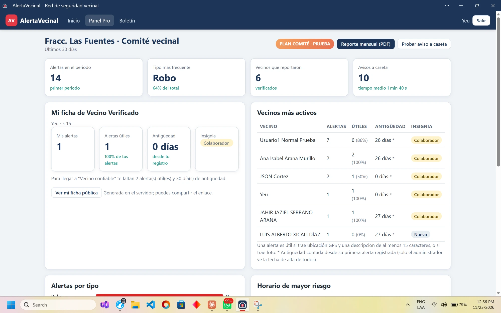
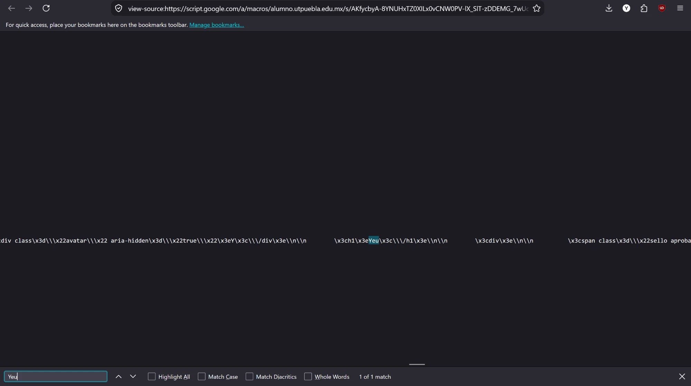

# Sección de Gonzalez Barrios Yeudiel Nain · Matrícula 2311081344

Integrante 3 del equipo AlertaVecinal · GitHub `yeudev-utp` · rama `yeudiel`.
Los números de los apartados corresponden a las secciones del documento del Producto 2 (spec 03).

---

## 7. Aportación: Vecino Verificado Pro

**Vecino Verificado Pro** es la propuesta de emprendimiento e innovación del Subproducto 5: AlertaVecinal sigue siendo gratuita para cada vecino, y los comités vecinales y fraccionamientos pagan por herramientas para administrar y analizar la seguridad de su colonia. En esta unidad la aportación pasó de maqueta a una función real de la PWA, con una parte en el cliente y otra en el servidor:

- **Panel Pro (vista del lado del cliente):** `estadisticas.html` y `js/estadisticas.js`. Calcula en el navegador, con las alertas de Firestore en tiempo real, los indicadores de la colonia (alertas del periodo, tipo más frecuente, horario de mayor riesgo y calles con más incidentes) y los indicadores de **Vecino Verificado**: alertas por vecino, alertas útiles, antigüedad e insignia (Nuevo, Colaborador, Vecino confiable y Guardián). Cada vecino ve además su propia ficha y lo que le falta para subir de insignia.
- **Ficha de Vecino Verificado (vista del lado del servidor):** `apps-script/Verificado.gs` y `apps-script/vista_verificado.html`. Google Apps Script lee el perfil y las alertas de Firestore y arma el HTML en el servidor. La ficha es pública para que el vecino la pueda compartir, por eso solo muestra datos no sensibles: nombre corto, estado, domicilio verificado, mes de alta, conteos e insignia.
- **Verificación de domicilio (backend):** la acción `accion_verificar` permite que el administrador marque el domicilio de un vecino como verificado. El servidor comprueba con el token de sesión que quien la usa es administrador aprobado y guarda la fecha con la hora del servidor. Es la parte "verificado" de la propuesta: reduce las alertas falsas porque el comité confirma quién vive en la colonia.

También desarrollé dos partes base de la PWA: el **panel de administración de usuarios** y el **botón de instalación**.

### Mis commits
| Commit | Fecha | Qué agrega |
|---|---|---|
| `Panel de administración de usuarios` | 20/11/2026 | `admin.html`, `js/admin.js`: lista de usuarios con filtros, aprobar, suspender, cambiar rol, eliminar y avisos a todos los vecinos |
| `Botón de instalación de la PWA` | 20/11/2026 | `js/instalar.js`: botón "Instalar app" con `beforeinstallprompt` e instrucciones para iPhone |
| `Aportación: Vecino Verificado Pro` | 23/11/2026 | Panel Pro con datos reales de Firestore |
| `Vista de servidor: ficha de Vecino Verificado` | 23/11/2026 | Ficha generada en Apps Script, `accion_verificar` y pruebas del backend |

---

## 2. Justificación de plataformas y herramientas (partes de Yeudiel)

| Herramienta | Para qué | Por qué se eligió | Alternativa descartada |
|---|---|---|---|
| Firestore `onSnapshot` | Panel Pro y panel de administración en tiempo real | Los indicadores y la lista de usuarios se actualizan solos cuando llega una alerta o cambia un perfil, sin recargar | Consultas periódicas (*polling*): más lecturas y datos desfasados |
| SVG generado con JavaScript | Gráfica de horario de mayor riesgo | Una gráfica de columnas no necesita librería: menos peso para la PWA y funciona sin conexión | Chart.js: agrega una dependencia externa para una sola gráfica |
| Google Apps Script + HtmlService | Ficha de Vecino Verificado (vista de servidor) y `accion_verificar` | Genera HTML en el servidor y usa la cuenta de servicio sin pagar el plan Blaze de Firebase | Cloud Functions: requiere plan de pago con tarjeta |
| Evento `beforeinstallprompt` | Botón "Instalar app" | Permite ofrecer la instalación en el momento adecuado con un botón propio en lugar del aviso automático del navegador | Depender solo del menú del navegador: muchos vecinos no saben que existe |
| Simulador de Apps Script en Node (`apps-script/pruebas/`) | Probar la ficha y la acción sin subir nada a Google | Pruebas repetibles y rápidas, sin tocar la base de datos real | Probar solo en el editor de Apps Script: lento y con datos reales |

---

## 3. Parámetros de configuración (partes de Yeudiel)

### Instalación (`js/instalar.js`)
| Parámetro | Valor | Explicación |
|---|---|---|
| Evento | `beforeinstallprompt` | Chrome y Edge lo lanzan cuando la PWA cumple los requisitos: manifest válido, service worker y HTTPS o localhost |
| `e.preventDefault()` | Sí | Evita el aviso automático y guarda el evento para el botón propio |
| Uso del evento | Una sola vez | Después de `prompt()` se descarta, como exige el navegador |
| Ya instalada | `display-mode: standalone` | Si la app ya corre instalada, el botón no se muestra |
| iPhone / iPad | Instrucción manual | Safari no tiene `beforeinstallprompt`: el botón explica "Compartir → Agregar a pantalla de inicio" |

### Reglas de Vecino Verificado (iguales en `js/estadisticas.js` y `apps-script/Verificado.gs`)
| Regla | Valor |
|---|---|
| Alerta útil | Trae ubicación GPS (`lat` y `lng`) **y** una descripción de 15 caracteres o más, **o** trae foto |
| Guardián | 8 alertas útiles y 90 días de antigüedad |
| Vecino confiable | 3 alertas útiles y 30 días |
| Colaborador | 1 alerta útil |
| Nuevo | Sin alertas útiles |
| Antigüedad | Desde `usuarios.creado`. Por las reglas de Firestore, solo el admin la ve para todos; cada vecino ve la suya |

### Backend en Apps Script (`apps-script/Verificado.gs`)
| Elemento | Valor |
|---|---|
| Vista | `GET …/exec?vista=verificado&uid=<uid>` |
| Acción | `POST {accion: "verificar", idToken, uid, verificado: true\|false}` (cuerpo como `text/plain` para evitar la verificación CORS previa) |
| Validación | `uid` solo letras y números (1–128); quien llama debe ser **admin aprobado** (`verificarSesion_` con `rol: 'admin'`) |
| Campos que guarda en `usuarios/{uid}` | `verificado` (booleano), `verificadoEn` (hora del servidor), `verificadoPor` (uid del admin) |
| Privacidad de la ficha | Sin correo, teléfono, calle, número, descripciones ni coordenadas; si el vecino no existe o no está aprobado se muestra una página genérica |
| Propiedades del script nuevas | Ninguna (usa la `SERVICE_ACCOUNT` del núcleo) |
| Despliegue | `clasp push` y nueva versión de la implementación |

---

## 4. Reporte de pruebas (casos de Yeudiel)

Solo se marcan ✅ las pruebas que se realizaron. Las pruebas Y-04, Y-13, Y-14 e Y-15 se hicieron con la app publicada, el backend v4 y la cuenta real del integrante.

| ID | Requisito | Pasos | Resultado esperado | Resultado obtenido | Estado |
|---|---|---|---|---|---|
| Y-01 | Panel de administración | Abrir `?demo=1` → menú **Administración** | Formulario de avisos y tabla de usuarios con Aprobar, Hacer admin, Suspender y Eliminar | Se muestran ambos con los usuarios de ejemplo (20/11) | ✅ |
| Y-02 | Verificar domicilio | En Administración (`?demo=1`) pulsar **Verificar domicilio** en un vecino aprobado | Aparece el chip "Domicilio verificado" y el botón cambia a "Quitar verificación" | Correcto con el vecino de ejemplo (23/11) | ✅ |
| Y-03 | Carga del módulo de instalación | Abrir `?demo=1` con F12 → Console | Ya no aparece el aviso de `js/instalar.js` no disponible | Sin el aviso; en ventana privada el botón no aparece, lo cual es esperado (20/11) | ✅ |
| Y-04 | Instalación de la PWA | Abrir la URL publicada en Edge (ventana normal) → **Instalar app** | La app abre en su propia ventana, sin barra del navegador y con ícono en la barra de tareas | Instalada en Edge; abre como "AlertaVecinal - Red de seguridad vecinal" en ventana propia (25/11, Figura de la app instalada) | ✅ |
| Y-05 | Menú Panel Pro | Abrir `?demo=1` | El menú muestra **Panel Pro** y ya no hay 404 de `js/estadisticas.js` | Correcto (23/11) | ✅ |
| Y-06 | Indicadores de la colonia | Abrir Panel Pro en `?demo=1` | Alertas del periodo, tipo más frecuente, vecinos, avisos a caseta y gráficas | 40 alertas en 30 días, Robo 48 %, 5 vecinos, gráficas por tipo y horario (23/11) | ✅ |
| Y-07 | Alertas por vecino | Revisar la tabla **Vecinos más activos** | Alertas, útiles, antigüedad e insignia, sin correos ni ubicaciones | Correcto; sin datos sensibles (23/11) | ✅ |
| Y-08 | Mi ficha | Revisar **Mi ficha de Vecino Verificado** | Mis alertas, útiles, antigüedad, insignia y lo que falta para la siguiente | 7 alertas, 7 útiles, 15 días, Colaborador (23/11) | ✅ |
| Y-09 | Acceso al Panel Pro | Abrir `estadisticas.html` sin sesión | Se pide iniciar sesión y el panel queda oculto | Correcto (23/11) | ✅ |
| Y-10 | Vista de servidor: ficha | `node apps-script/pruebas/prueba_verificado.mjs` | La ficha se genera en el servidor con nombre corto, conteos, insignia y pie "Generado en el servidor" | 12/12 pruebas correctas (23/11) | ✅ |
| Y-11 | Privacidad de la ficha | Mismo script | El HTML no contiene correo, teléfono, domicilio, descripciones ni coordenadas; uid inválido o pendiente → página genérica | Correcto (23/11) | ✅ |
| Y-12 | Permisos del backend | Mismo script: `accion_verificar` con vecino, sin token y con admin | Solo el admin verifica; se guarda con hora del servidor | Correcto (23/11) | ✅ |
| Y-13 | Ficha publicada | Panel Pro → **Ver mi ficha pública** y ver el código fuente (Ctrl + U) | Ficha con datos reales, pie "Generado en el servidor" y los datos ya incrustados en el HTML | Ficha de "Yeu": 1 alerta, 1 útil, 100 %, Colaborador; el código fuente contiene `<h1>Yeu</h1>` (25/11) | ✅ |
| Y-14 | Verificación real | El administrador pulsa **Verificar domicilio** en Administración con el backend publicado | La ficha muestra "Domicilio verificado por el comité" con la fecha del servidor | "Domicilio verificado por el comité · Verificado el 24 de noviembre de 2026" (25/11) | ✅ |
| Y-15 | Panel Pro con datos reales | Enviar una alerta real y abrir **Panel Pro** | Indicadores de la colonia, Mi ficha y Vecinos más activos con datos de Firestore | 14 alertas en 30 días, 6 vecinos; Mi ficha: 1 alerta útil, antigüedad "desde tu registro" (25/11) | ✅ |

---

## 5. Evidencias de las características de la PWA (partes de Yeudiel)

---

## 8. Conclusión de Gonzalez Barrios Yeudiel Nain

Trabajar en AlertaVecinal me dejó claro que una PWA no es solo una página que se puede instalar. El botón de instalación parece algo pequeño, pero para una app de emergencias importa mucho que el vecino la tenga en su pantalla de inicio y no tenga que buscarla en el navegador cuando pasa algo.

Con el panel de administración entendí la importancia de las reglas de seguridad: la interfaz puede ocultar botones, pero quien realmente decide qué puede hacer cada usuario es Firestore, y en el caso de la verificación, el servidor. Por eso la acción de verificar un domicilio se valida en Apps Script con el token de sesión y no solo en el navegador.

Mi aportación, Vecino Verificado Pro, me obligó a pensar en la aplicación como un servicio que debe sostenerse. Al convertir la maqueta en un panel con datos reales tuve que definir criterios objetivos, como qué es una alerta útil, y respetar la privacidad: la ficha pública muestra lo necesario para generar confianza sin exponer el domicilio ni el teléfono del vecino. También aprendí a generar vistas del lado del servidor y a probarlas con un simulador antes de publicarlas, lo que hace el trabajo en equipo más ordenado y seguro.

— Gonzalez Barrios Yeudiel Nain
